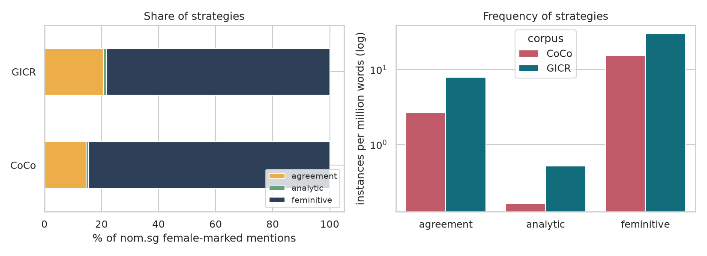
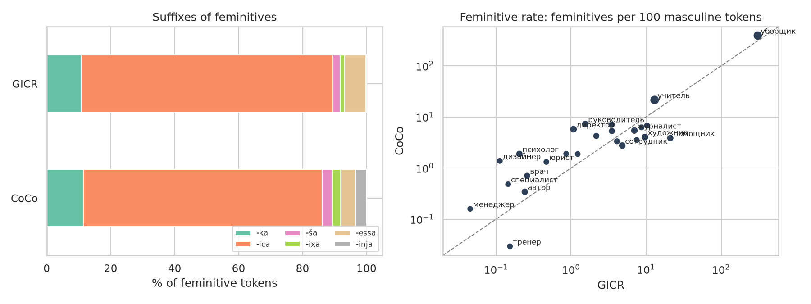
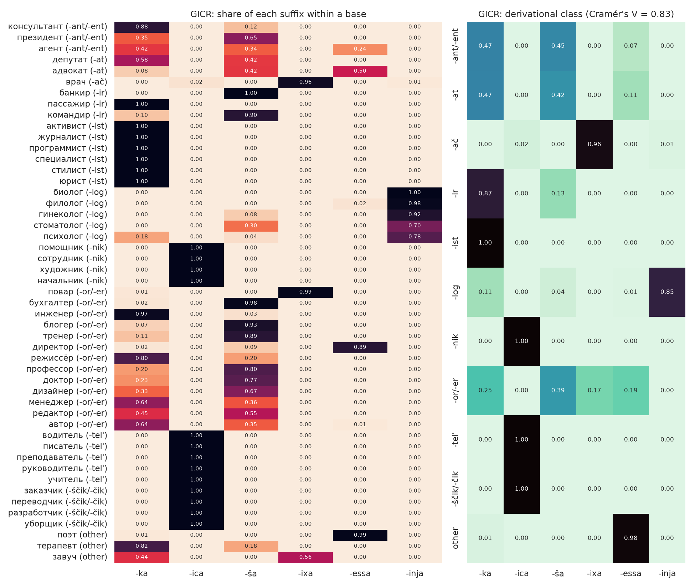
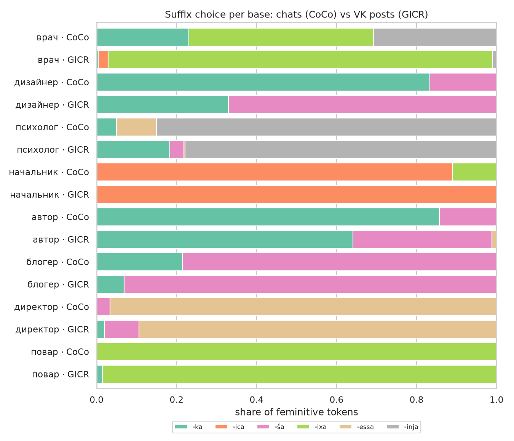
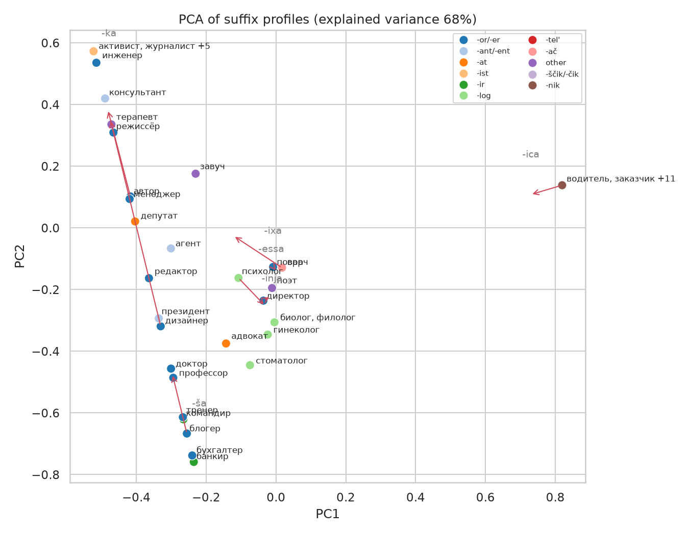

# Strategies of Feminine Reference in Russian Online Communication: Group Chats vs. VK Posts

**Vera Smirnova** · Final project · *Linguistic Data: Quantitative Analysis and Visualisation* · HSE University, October 2026

> **In short.** Comparing 15 Telegram group chats (CoCo, 24 M words) with VK posts from the General Internet Corpus of Russian (GICR, 15.6 B words)
> for 50 profession/role nouns, I find that (1) both corpora name women mainly with morphological feminitives, and chats differ only slightly in suffix flavour;
> (2) the choice of a feminitive suffix is decided by the individual base and its derivational class (Cramér's V = 0.83), not by global suffix productivity;
> (3) the two corpora agree on the dominant suffix of a base and diverge only where the norm is still unsettled (*врач, дизайнер, автор*).

## 1. Background and research questions

Russian has several ways to refer to a woman by a noun of profession or social role:

| strategy | example |
|---|---|
| suffixal **feminitive** | *авторка, учительница, директорша, врачиха, поэтесса, психологиня* |
| masculine noun + feminine **agreement** | *наша врач*, *врач сказала* |
| **analytic** construction | *женщина-врач*, *женщина директор* |

Feminitives themselves compete: one base can take several suffixes (*авторка / авторша / авторесса*).
Earlier work usually ranks suffixes by overall productivity (“*-ka* is the most productive”).
This project asks whether that picture holds when we look **inside individual bases** and **across two kinds of online communication**.

* **RQ1.** Do group chats (CoCo) and public VK posts (GICR) differ in which strategy is used?
* **RQ2.** Is the choice of a feminitive suffix a property of the individual base rather than of global suffix productivity?
* **RQ3.** Does the competition inside one base look the same in both corpora?

Hypotheses: **H1** chats rely more on morphological feminitives and on colloquial suffixes (*-ša*, *-ixa*) than VK posts;
**H2** suffix choice is strongly predicted by the base and its derivational class, and a global ranking hides this;
**H3** bases with real competition differ between the corpora more than bases with one established feminitive.

## 2. Data

| corpus | what it is | size (words) | access |
|---|---|---|---|
| **CoCo** — Corpus of Correspondence | 15 Telegram group chats: sport (4), video games (3), student dormitories (4), fandoms (4); 4.1 M messages | 24.4 M | private; only aggregated counts are published |
| **GICR** — General Internet Corpus of Russian, VK section | public VK posts and comments, part of the Russian National Corpus | 15.6 B | RNC public API, one query per item |

**Lexicon** (`data/lexicon.csv`): 50 masculine bases of profession/role nouns from 11 derivational classes
(*-or/-er, -ist, -ir, -ščik/-čik, -nik, -tel', -ač, -log, -ant/-ent, -at*, other) and 88 feminitive lemmas built with six suffixes:
*-ka*, *-ica* (incl. *-nica*), *-ša*, *-ixa*, *-essa/-isa*, *-inja*.

## 3. Method

**Strategies and queries.** The same five measurements are taken in both corpora:

| measurement | CoCo (`src/coco_search.py`) | GICR (`src/gicr_collect.py`) |
|---|---|---|
| feminitive, all forms | regular expression for every inflected form of the lemma | `lex = авторка` |
| feminitive, nom.sg | the lemma form itself | `lex = авторка, gramm = nom,sg` |
| agreement with an adjective/pronoun | fem. nom.sg adjective/pronoun (pymorphy3) + base in nom.sg | `(A\|APRO),f,nom,sg` + `lex = base, nom,sg`, distance 1 |
| agreement with a verb | base in nom.sg + fem. past-tense verb (pymorphy3) | `lex = base, nom,sg` + `V,praet,f`, distance 1 |
| analytic construction | *женщина* + base (space or hyphen) | `lex = женщина, nom,sg` + `lex = base, nom,sg`, distance 1 |
| masculine base, all forms | regular expression | `lex = base` |

**Comparability.** Strategies are compared on **nominative singular** mentions only, because agreement can only be detected in nom.sg frames.
Agreement is caught only when the agreeing word is adjacent, so its share is a lower bound in both corpora.

**Cleaning.** In CoCo, adjacency may not cross punctuation or a line break: chat templates like
*«м. Нагорная↵Тренер: …»* would otherwise be counted as *«нагорная тренер»*.
The RNC distance condition ignores punctuation, so for GICR every two-word query was checked on a sample of concordance lines
(`src/gicr_precision.py`), and raw counts are multiplied by the share of clean lines.

**Measures.** Frequencies per million words (ipm); χ² test and Cramér's V for strategy × corpus, suffix × corpus and derivational class × suffix;
Shannon entropy (bits) of the suffix distribution inside a base; Jensen–Shannon distance between the distributions of one base in two corpora
and between a base and the global distribution; PCA of the base × suffix matrix.

**Tools.** SQLite, regular expressions, pymorphy3 morphological analysis, the RNC REST API, pandas, SciPy, scikit-learn, matplotlib/seaborn.

## 4. Results

All numbers below are produced by [`notebooks/feminine_reference.ipynb`](notebooks/feminine_reference.ipynb).

### 4.1 RQ1: strategies of feminine reference



| nom.sg mentions | CoCo, tokens | CoCo, % | GICR, tokens | GICR, % |
|---|---|---|---|---|
| feminitive (*авторка*) | 378 | 84.6 | 470 127 | 78.1 |
| agreement (*наша врач*, *врач сказала*) | 65 | 14.5 | 123 720 | 20.6 |
| analytic (*женщина-врач*) | 4 | 0.9 | 7 999 | 1.3 |

* In both corpora a woman is named mainly with a **morphological feminitive**; analytic constructions are marginal (about 1%).
* Chats use feminitives slightly more and agreement slightly less than VK posts. The difference is significant only because GICR is huge
  (χ² = 10.9, p = 0.004) and is negligible as an effect (Cramér's V = 0.004).

### 4.2 Feminitives: frequency and suffixes



* Feminitives are about **twice as frequent in VK posts** as in chats (61.8 vs 30.8 per million words): chats simply talk about professions less.
  But relative to its masculine base, a noun is feminized **more often in chats**: 16 of 25 bases lie above the diagonal (right panel).
  The clearest exception is *тренер*: sports chats mention (mostly male) coaches a lot and *тренерша* almost never.
* The overall suffix profile is dominated by *-ica* in both corpora, because the lexicon includes frequent *-tel'/-nik/-ščik* bases (*учительница, сотрудница, уборщица*).
  The difference between the corpora is statistically significant but small (χ² = 455, df = 5, Cramér's V = 0.02), and systematic:
  chats use more of the expressive and colloquial suffixes **-inja** (3.5% vs 0.2%: *психологиня, врачиня*), **-ixa** (2.7% vs 1.4%) and **-ša** (3.1% vs 2.4%),
  and fewer *-essa/-isa* (4.7% vs 6.7%). The share of *-ka* is the same (11.4% vs 10.8%).

### 4.3 RQ2: competition inside a base



* Globally, suffix choice looks uncertain: the entropy of the overall GICR suffix distribution is **1.11 bits**.
  Inside a base it is only **0.37 bits** on average (bases with ≥ 30 tokens), and in **61%** of bases one suffix takes more than 90% of the tokens.
  The mean Jensen–Shannon distance between a base and the global distribution is 0.74 (on a 0–1 scale): almost no base behaves like the “average”.
* The derivational class of the masculine base predicts the suffix very strongly (**Cramér's V = 0.83**):
  *-ist → -ka*, *-nik / -tel' / -ščik → -ica*, *-log → -inja*, *-ač → -ixa* are practically categorical.
* Real competition is concentrated in **borrowed bases on -or/-er, -ant/-ent, -at**: *агент* (-ka 42%, -ša 34%, -essa 24%; H = 1.55),
  *адвокат* (-essa 50%, -ša 42%), *автор* (-ka 64%, -ša 35%), *редактор* (-ša 55%, -ka 45%), *депутат* (-ka 58%, -ša 42%), *президент* (-ša 65%).
* Even inside one class the base decides: *доктор, профессор → -ša* (77–80%), *инженер, режиссёр → -ka* (80–97%), *директор → -isa* (*директриса*, 89%), *повар → -ixa* (99%).
  This confirms the expectation from the proposal review: *автор* prefers *-ka* (64%), while *доктор* prefers *-ša* (*докторша*, 77%).

### 4.4 RQ3: the same bases in chats and VK posts



* 18 bases have at least 5 feminitive tokens in both corpora. The dominant suffix coincides in **17 of 18**; the only exception is *дизайнер*
  (chats: *дизайнерка*, 5 of 6; VK: *дизайнерша*, 67%).
* Ten of these bases use a single suffix in both corpora (*учительница, журналистка, сотрудница…*). Differences appear only where VK posts already show
  competition: the entropy of a base in GICR and its distance between the corpora are strongly correlated (Spearman ρ = 0.91).
  The largest shift is *врач*: VK posts use *врачиха* (96%), chats split between *врачиха* (46%), *врачиня* (31%) and *врачка* (23%).

### 4.5 A typological map of bases



PCA of the base × suffix matrix (two components explain 68% of the variance) turns the picture into a map with poles for *-ica*, *-ka*, *-ša* and *-inja/-ixa/-essa*.
Bases of the categorical classes sit exactly on the poles; borrowed *-or/-er* bases are spread along the *-ka ↔ -ša* axis.
Arrows show where a base moves in the chats: *дизайнер* moves towards *-ka*, *врач* away from the *-ixa* pole.

## 5. Conclusions

1. **Strategy (RQ1).** Chats and VK posts name women by profession in the same way: mostly with a morphological feminitive, sometimes with
   feminine agreement on a masculine noun, almost never analytically. **H1 is supported only partly**: chats do not prefer another strategy,
   but they feminize a base relatively more often and use the expressive suffixes *-inja, -ixa, -ša* a little more.
2. **Lexical competition (RQ2).** **H2 is supported.** A global ranking of suffixes mostly reflects which bases are in the sample.
   The real unit of suffix choice is the base: for native classes the derivational class almost fixes the suffix,
   and competition lives in borrowed bases on *-or/-er, -ant/-ent, -at*, where each base has its own preference (*авторка* but *докторша*, *директриса*).
3. **Two corpora (RQ3).** **H3 is supported.** Chats and VK posts agree on the dominant suffix of a base; they diverge exactly where the norm
   is not settled yet (*врач, дизайнер, автор, психолог*).

For a study of feminitives this means that sampling, statistics and visualisation should be done **per base**, not per suffix.

## 6. Limitations

* **CoCo is small for this question**: 752 feminitive tokens, many of them from a few items; the notebook reports how many chats each item occurs in.
  Cross-corpus comparisons are limited to 18 bases with at least 5 tokens.
* **The lexicon is mine** (50 bases, 88 lemmas): only listed feminitives are counted, so rare or new forms outside the list are missed.
* **Agreement** is detected only in adjacent nom.sg frames and is a lower bound. The GICR precision correction is based on 25 concordance lines per query
  from the first result page, not a random sample.
* GICR annotation is automatic; lemmatization of rare feminitives may vary.
* The masculine base count includes generic and male reference, so the feminitive rate is a relative index, not a share of female reference.
* CoCo hits were spot-checked, not validated manually one by one.

## 7. Repository structure and how to reproduce

```
data/        lexicon, aggregated counts (CoCo, GICR), corpus sizes, GICR precision sample
src/         data collection scripts
notebooks/   feminine_reference.ipynb: all analyses and figures
figures/     figures used in this README
```

```bash
pip install -r requirements.txt
# GICR (no token needed, about 1 hour because of API rate limits)
python src/gicr_collect.py && python src/gicr_precision.py
# CoCo (needs the private chat exports)
python src/coco_flatten.py RAW_DIR coco.sqlite && python src/coco_search.py coco.sqlite local_hits.csv
# analysis
jupyter nbconvert --to notebook --execute notebooks/feminine_reference.ipynb
```

The notebook runs from the files in `data/` alone, so all results can be checked without access to CoCo.

## 8. Data and privacy

CoCo consists of private group chats. The repository contains **no message texts, user names or user ids** from CoCo:
only counts per chat topic, base and form. GICR counts come from the public RNC API; no GICR texts are stored either.

## References

* Russian National Corpus. https://ruscorpora.ru
* Belikov V., Kopylov N., Piperski A., Selegey V., Sharoff S. (2013). Big and diverse is beautiful: A large corpus of Russian to study linguistic variation. *Proceedings of the 8th Web as Corpus Workshop (WAC-8)*.
* Korobov M. (2015). Morphological analyzer and generator for Russian and Ukrainian languages. *Analysis of Images, Social Networks and Texts (AIST 2015)*.
